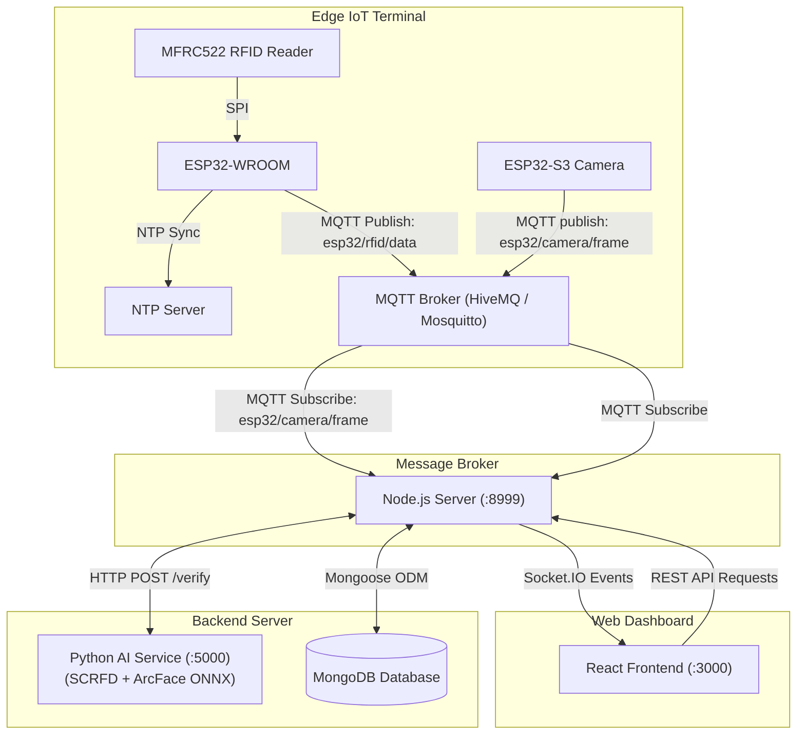

# Smart IoT Timekeeping & Access Control System with AI Face Verification

An end-to-end intelligent IoT timekeeping and attendance verification system built with **ESP32 / ESP32-S3**, **RC522 RFID**, **Node.js (Express, Socket.IO, MQTT)**, **Python AI (InsightFace ArcFace ONNX)**, **MongoDB**, and a **React** web dashboard.

---

## Overview

The system delivers robust two-factor verification (2FA) for attendance and access control:
1. **Factor 1 (Possession)**: Contactless RFID card scanned at the edge terminal (ESP32).
2. **Factor 2 (Biometrics)**: Automated face capture via camera and real-time biometric verification using deep metric learning (ArcFace).

The RFID reader and camera run on separate boards. The ESP32-WROOM publishes card scans through MQTT, and the ESP32-S3 continuously publishes JPEG frames through MQTT. The backend uses the latest fresh camera frame when an RFID event arrives, retrieves the registered portrait, and queries the local Python AI microservice. Camera frames and attendance events reach the React dashboard through Socket.IO; Socket.IO is not used by either ESP32.

---

## System Architecture



---

## Key Features

- **Contactless Attendance Logging**: Instant card UID acquisition with millisecond timestamp synchronized via NTP.
- **Biometric Face Verification**: 
  - **Face Detection & Alignment**: InsightFace `SCRFD-10G`.
  - **Feature Embedding**: `ArcFace W600K R50` generating 512-D normalized embeddings.
  - **Local ONNX Runtime Inference**: High-performance inference supporting NVIDIA CUDA acceleration or CPU fallback without cloud latency or external privacy leaks.
- **Automated Anti-Buddy Punching**: Detects and rejects scans when the person presenting the card does not match the registered employee portrait.
- **Real-Time Web Dashboard (React)**:
  - **Live Attendance Feed**: Real-time event monitoring with captured photos, employee names, and similarity confidence scores.
  - **Live Camera Stream**: Real-time video preview for terminal monitoring.
  - **Attendance History**: Searchable, filterable check-in and check-out records.
  - **Employee Management**: Profile registry with portrait upload, department assignment, and RFID card binding.
  - **AI Verification Sandbox**: Independent tool to test face comparison directly from image files.

---

## Hardware Requirements & Pinout

### Components
- **ESP32-WROOM Development Board** for RFID
- **Freenova ESP32-S3-CAM** for camera streaming
- **RC522 RFID Module (13.56 MHz)**
- **Mifare Classic 1K RFID Cards / Keyfobs**
- **Jumper wires and 5V USB power supply**

### Pin Connection (ESP32-WROOM to RC522)

| RC522 Pin | ESP32-WROOM GPIO Pin | Function | Notes |
|:---------:|:-----------------:|:--------:|:-------|
| **SDA (SS)** | GPIO 5 | SPI Chip Select | |
| **SCK** | GPIO 18 | SPI Clock | |
| **MOSI** | GPIO 23 | SPI Master Out Slave In | |
| **MISO** | GPIO 19 | SPI Master In Slave Out | |
| **RST** | GPIO 22 | Reset | |
| **GND** | GND | Ground | Nối đất |
| **3.3V** | 3.3V | Power Supply | 3.3V (Tuyệt đối không cấp 5V) |

The ESP32-S3-CAM is dedicated to capturing and streaming frames; do not connect
the RC522 to it.

---

## Software Prerequisites

- **Node.js**: v18.x or v20.x LTS
- **Python**: 3.9 – 3.11 (with `pip` and virtual environment support)
- **MongoDB**: Community Server v6.x+ running locally or MongoDB Atlas
- **MQTT Broker**: Local EMQX Edge at the broker PC's LAN IP, TCP port `1883`
- **Arduino IDE** (with ESP32 board package) or **VS Code + PlatformIO**

---

## Installation & Setup

### Step 1: ESP32 Firmware

#### ESP32-WROOM RFID firmware
1. Open `ESP32_RC522/ESP32_WROOM_RFID` in VS Code with PlatformIO.
2. The board connects only to Wi-Fi `@Lhh`. Set the broker and topic in
   `include/device_config.h` only if they differ from the backend configuration.
3. Connect the ESP32-WROOM board and upload the `esp32dev` environment.

#### ESP32-S3 camera firmware
1. Open `ESP32_RC522/ESP32_S3_CAMERA` in VS Code with PlatformIO.
2. The board connects only to Wi-Fi `@Lhh` and publishes camera frames to
   `esp32/camera/frame`. Keep this topic and the broker aligned with the backend
   `.env` settings.
3. Configure the OTA settings, then upload to the ESP32-S3-CAM.

The Arduino IDE entry point for the WROOM reader is `ESP32_RC522/ESP32_RC522.ino`.
Open it from the `ESP32_RC522` folder and install these libraries:
   - `MFRC522` by GithubCommunity
Select **ESP32 Dev Module** and upload to the WROOM. The firmware connects to
Wi-Fi `@Lhh`.
The firmware uses the ESP32 Arduino core MQTT client and sends scans with QoS 1.

---

### Step 2: Python AI Service

The AI microservice performs local face detection and ArcFace feature extraction.

1. Navigate to the AI directory:
   ```bash
   cd Server/be/AI_model
   ```

2. Create and activate a virtual environment:
   ```bash
   python -m venv venv
   # On Windows:
   venv\Scripts\activate
   # On Linux/macOS:
   source venv/bin/activate
   ```

3. Install required dependencies:
   ```bash
   pip install -r requirements.txt
   ```
   > **Note for NVIDIA GPU users**: If using CUDA 12.x, `onnxruntime-gpu[cuda,cudnn]==1.26.0` utilizes bundled DLLs without requiring system-wide CUDA installation. For CPU-only environments, install `onnxruntime>=1.16.0`.

4. Prepare ONNX Models:
   Place the following model files into `Server/be/AI_model/models/`:
   - `scrfd_10g.onnx` (Face Detection)
   - `arcface_w600k_r50.onnx` (Feature Recognition)

5. Test the service manually:
   ```bash
   python ai_service.py
   ```
   The service will listen on `http://127.0.0.1:5000`. (You can also run `start_ai_service.bat` on Windows).

---

### Step 3: Node.js Backend

1. Navigate to the backend directory:
   ```bash
   cd Server/be
   ```

2. Install Node.js packages:
   ```bash
   npm install
   ```

3. Configure environment variables in `Server/be/.env`:
   ```env
   SERVER_PORT=8999
   DATABASE_HOST=127.0.0.1:27017
   DATABASE_QUERY=ESP32
   MQTT_HOST=mqtt://10.174.100.95:1883
   MQTT_TOPIC=esp32/rfid/data
   MQTT_CAMERA_FRAME_TOPIC=esp32/camera/frame
   MQTT_CAMERA_STATUS_TOPIC=esp32/camera/status
   CAMERA_FRAME_MAX_AGE_MS=500
   AI_SERVICE_URL=http://127.0.0.1:5000
   AI_SERVICE_AUTOSTART=true
   FACE_DETECTION_MODEL=scrfd_10g.onnx
   FACE_RECOGNITION_MODEL=arcface_w600k_r50.onnx
   CAMERA_JPEG_QUALITY=40
   ```
   `10.174.100.95` is the current IPv4 address of the PC running EMQX Edge.
   The WROOM and S3 firmware use this same broker address. If the PC receives a
   different address, update `MQTT_HOST` in `.env`, `MQTT_HOST` in
   `ESP32_WROOM_RFID/include/device_config.h`, and `mqttBrokerUri` in
   `PlatformIO/src/main.cpp`, then restart the backend and reflash both boards.

#### EMQX Edge LAN requirements
- Start `emqx-edge.exe` from its installation directory so it loads
  `nanomq.conf`. The TCP listener is `0.0.0.0:1883`.
- Keep the PC and both ESP32 boards on the same Wi-Fi/LAN (`@Lhh`). Do not use
  `localhost` or `127.0.0.1` in ESP32 broker settings.
- Reserve the PC address `10.174.100.95` in the router DHCP settings, or update
  all three broker settings if it changes.
- Allow inbound TCP port `1883` for `emqx-edge.exe` in Windows Firewall on the
  active Wi-Fi profile. The current Wi-Fi profile is `Public`, and no explicit
  inbound MQTT rule was found. In an elevated PowerShell, add a LAN-only rule:
  ```powershell
  New-NetFirewallRule -DisplayName "EMQX Edge MQTT (LAN only)" `
    -Direction Inbound -Action Allow `
    -Program "D:\Hust_PhD\Subject\IoT\MQTT_Server\emqx-edge-1.5.0-windows-x86_64\emqx-edge.exe" `
    -Protocol TCP -LocalPort 1883 -RemoteAddress LocalSubnet -Profile Public
  ```
  Wi-Fi client isolation must be disabled. A successful connection test on the
  broker PC itself does not verify that another LAN device can pass the firewall.
- This local config currently permits anonymous MQTT access and has MQTT
  password authentication and ACL disabled. Use only on a trusted LAN; do not
  expose port `1883` to the public Internet.
- Camera JPEG packets can exceed the old 1054-byte client limit. The supplied
  `nanomq.conf` now sets `client_max_packet_size = 1MB`; restart EMQX Edge after
  this change.

4. Start the backend:
   ```bash
   npm start
   ```
   The server runs on `http://localhost:8999`. If `AI_SERVICE_AUTOSTART=true`, Node.js will automatically launch the Python AI service if it is not already running.

---

### Step 4: React Web Frontend

1. Navigate to the frontend directory:
   ```bash
   cd Server/fe
   ```

2. Install dependencies:
   ```bash
   npm install
   ```

3. Verify environment configuration in `Server/fe/.env`:
   ```env
   PORT=3000
   REACT_APP_API_BASE_URL=http://localhost:8999/api/V1/Developer
   REACT_APP_SOCKET_URL=http://localhost:8999
   REACT_APP_ENV=development
   ```

4. Start the development server:
   ```bash
   npm start
   ```
   The web dashboard will open at `http://localhost:3000`.

---

## Operating Flow

1. **User Registration**:
   - Open the web dashboard and go to **User Management** (`/access/admins/users`).
   - Add a new user with their full name, department, phone, email, and upload a clear portrait photo.
   - Assign their physical RFID card number (e.g., `0003184643`).

2. **Timekeeping Scan**:
   - In **Live Camera**, choose either the desktop camera attached to the backend AI service or ESP32-S3 MQTT camera, then save the selection. The active source is stored in MongoDB collection `Config` and read by the backend for each RFID scan.
   - The employee taps their RFID card onto the RC522 reader.
   - ESP32-WROOM reads the UID and sends an MQTT packet (`esp32/rfid/data`).
   - ESP32-S3 continuously publishes camera frames to MQTT (about 4 frames/second, QoS 0).
   - The backend first journals every received RFID payload in the ignored local `Server/be/.rfid-inbox/`, then retries writing it to `RfidScanEvents` until MongoDB confirms it. The local journal is removed only after the database write succeeds.
   - It tries the saved camera source first, then the other camera as a fallback. For ESP32 it uses a frame received within 500 ms and waits up to 2 seconds for a fresh frame.
   - If neither camera is available, the event remains saved as `CAMERA_RETRYING`; capture continues until an image is obtained. Pending scans are resumed after backend restart or MQTT reconnect.
   - The backend forwards camera frames to the frontend over Socket.IO.
   - The AI service calculates cosine similarity between the live face and the registered portrait.

3. **Attendance Decision**:
   - **MATCH (Similarity >= 0.40)**:
     - Access granted.
     - Check-in or Check-out event saved with timestamp, device ID, selected camera source, and photo.
     - Real-time `rfid-scan-completed` event broadcast to the dashboard.
   - **MISMATCH (Similarity < 0.40 or Face Not Found)**:
     - Access rejected.
     - The scan image and failure details are saved in `RfidScanEvents` and mirrored to `RejectedScans`; no attendance check-in/out is created.
     - Instant `rfid-scan-rejected` alert with the image and similarity details is pushed to the dashboard.
   - **CAMERA UNAVAILABLE**:
     - The scan stays pending in `RfidScanEvents` while both camera sources are unavailable. The image is added when either source becomes available; a disconnected camera cannot provide a photo until it reconnects.
   - **UNASSIGNED CARD**:
     - Logged as an unassigned client for administrator review.

---

## Project Structure

```text
ESP32-S3_timekeeping/
├── ESP32_RC522/               # Embedded firmware
│   ├── ESP32_RC522.ino        # Arduino IDE entry point for WROOM
│   ├── ESP32_WROOM_RFID/      # ESP32-WROOM RFID + MQTT PlatformIO project
│   ├── Chân kết nối.txt       # Hardware pin connection notes
│   ├── ESP32_S3_CAMERA/        # ESP32-S3 camera + MQTT PlatformIO project
│   └── ESP32_WROOM_RFID/       # ESP32-WROOM RFID + MQTT PlatformIO project
│       ├── platformio.ini     # PlatformIO dependencies & config
│       └── src/               # Firmware source code
├── Server/
│   ├── be/                    # Node.js backend
│   │   ├── server.js          # Entry point & bootstrap
│   │   ├── app.js             # Express & Socket.IO server initialization
│   │   ├── .env               # Backend configuration
│   │   ├── base_connects/     # Connection handlers (MQTT, Socket.IO, AI)
│   │   ├── database_model/    # Mongoose schemas (Users, InfoCheckInOut, RejectedScans, RfidScanEvents, Config)
│   │   ├── routers/           # Express API route declarations
│   │   ├── utils/             # Camera capture & image utilities
│   │   ├── v1/                # Business logic, controllers & device events
│   │   └── AI_model/          # Python AI microservice
│   │       ├── ai_service.py  # Flask/REST API for face verification
│   │       ├── models/        # ONNX model directory (SCRFD & ArcFace)
│   │       ├── requirements.txt # Python dependencies
│   │       └── start_ai_service.bat # Startup script
│   └── fe/                    # React frontend
│       ├── .env               # Frontend environment settings
│       ├── package.json       # React dependencies and scripts
│       ├── public/            # Static HTML & assets
│       └── src/               # React components, pages & routes
│           ├── components/page/admin/
│           │   ├── CheckInRealtime/   # Live scan monitoring
│           │   ├── CheckInEvent/      # Attendance history
│           │   ├── LiveCamera/        # Real-time camera feed
│           │   ├── UserManagement/    # Employee & card administration
│           │   └── FaceVerification/  # Biometric testing tool
│           └── router/AppRoutes.js    # Route mappings
└── README.md                  # Project documentation
```

---

## License & Author

Developed for IoT and Smart System applications.

- **Author**: Le Hoang Huy
- **Email**: huyle.bkict@gmail.com
- **LinkedIn**: [Hoang Huy Le](https://www.linkedin.com/in/hoang-huy-le-35603b342)
