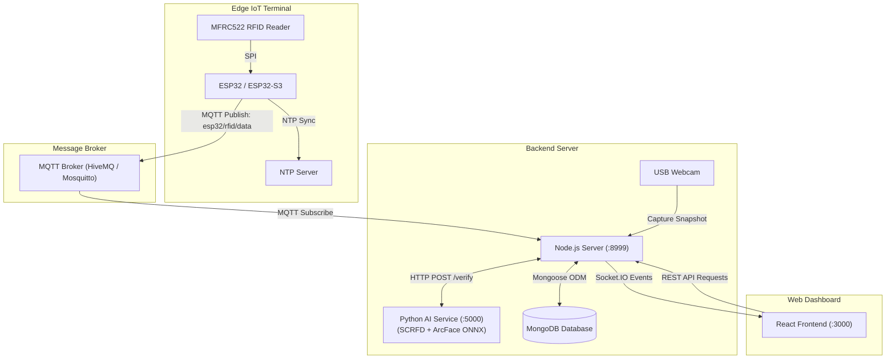

# Smart IoT Timekeeping & Access Control System with AI Face Verification

An end-to-end intelligent IoT timekeeping and attendance verification system built with **ESP32 / ESP32-S3**, **RC522 RFID**, **Node.js (Express, Socket.IO, MQTT)**, **Python AI (InsightFace ArcFace ONNX)**, **MongoDB**, and a **React** web dashboard.

---

## Overview

The system delivers robust two-factor verification (2FA) for attendance and access control:
1. **Factor 1 (Possession)**: Contactless RFID card scanned at the edge terminal (ESP32).
2. **Factor 2 (Biometrics)**: Automated face capture via camera and real-time biometric verification using deep metric learning (ArcFace).

When an employee scans their RFID card, the ESP32 publishes an event through MQTT. The Node.js backend immediately triggers a webcam snapshot, retrieves the employee's registered portrait, and queries a local Python AI microservice. If the facial cosine similarity exceeds the verification threshold, the check-in/check-out event is logged in MongoDB and broadcast to the React dashboard in real time. If a face mismatch or unauthorized scan is detected, access is rejected and security alerts are pushed instantly.

---

## System Architecture



---

## Key Features

- **Contactless Attendance Logging**: Instant card UID acquisition with millisecond timestamp synchronized via NTP.
- **Biometric Face Verification**: 
  - **Face Detection & Alignment**: InsightFace `SCRFD-10G`.
  - **Feature Embedding**: `ArcFace W600K R50` generating 512-D normalized embeddings.
  - **Local ONNX Runtime Inference**: High-performance inference supporting NVIDIA CUDA acceleration or CPU fallback without cloud latency or external privacy leaks.
- **Automated Anti-Buddy Punching**: Detects and rejects scans when the person presenting the card does not match the registered employee portrait.
- **Real-Time Web Dashboard (React)**:
  - **Live Attendance Feed**: Real-time event monitoring with captured photos, employee names, and similarity confidence scores.
  - **Live Camera Stream**: Real-time video preview for terminal monitoring.
  - **Attendance History**: Searchable, filterable check-in and check-out records.
  - **Employee Management**: Profile registry with portrait upload, department assignment, and RFID card binding.
  - **AI Verification Sandbox**: Independent tool to test face comparison directly from image files.

---

## Hardware Requirements & Pinout

### Components
- **ESP32 / ESP32-S3 Development Board**
- **RC522 RFID Module (13.56 MHz)**
- **Mifare Classic 1K RFID Cards / Keyfobs**
- **USB Webcam** (connected to the host server)
- **Jumper wires and 5V USB power supply**

### Pin Connection (ESP32 to RC522)

| RC522 Pin | ESP32 GPIO Pin | Function |
|:---------:|:--------------:|:--------:|
| **SDA (SS)** | GPIO 5 | SPI Chip Select |
| **SCK** | GPIO 18 | SPI Clock |
| **MOSI** | GPIO 23 | SPI Master Out Slave In |
| **MISO** | GPIO 19 | SPI Master In Slave Out |
| **RST** | GPIO 22 | Reset |
| **GND** | GND | Ground |
| **3.3V** | 3.3V | Power Supply (Do NOT connect to 5V) |

---

## Software Prerequisites

- **Node.js**: v18.x or v20.x LTS
- **Python**: 3.9 – 3.11 (with `pip` and virtual environment support)
- **MongoDB**: Community Server v6.x+ running locally or MongoDB Atlas
- **MQTT Broker**: Public HiveMQ (`broker.hivemq.com:1883`) or a local Eclipse Mosquitto broker
- **Arduino IDE** (with ESP32 board package) or **VS Code + PlatformIO**

---

## Installation & Setup

### Step 1: ESP32 Firmware

#### Option A: PlatformIO (Recommended)
1. Open the project folder in VS Code with the PlatformIO extension installed.
2. Navigate to `ESP32_RC522/PlatformIO`.
3. Verify or adjust Wi-Fi credentials and MQTT broker in `src/main.cpp` (or `ESP32_RC522/ESP32_RC522.ino`).
4. Connect the ESP32 board via USB and click **Upload**.

#### Option B: Arduino IDE
1. Open `ESP32_RC522/ESP32_RC522.ino`.
2. Install required libraries via Library Manager:
   - `PubSubClient` by Nick O'Leary
   - `MFRC522` by GithubCommunity
3. Select board **ESP32 Dev Module** and the corresponding COM port.
4. Update `ssid` and `password` variables to match your local Wi-Fi network.
5. Compile and upload to the board.

---

### Step 2: Python AI Service

The AI microservice performs local face detection and ArcFace feature extraction.

1. Navigate to the AI directory:
   ```bash
   cd Server/be/AI_model
   ```

2. Create and activate a virtual environment:
   ```bash
   python -m venv venv
   # On Windows:
   venv\Scripts\activate
   # On Linux/macOS:
   source venv/bin/activate
   ```

3. Install required dependencies:
   ```bash
   pip install -r requirements.txt
   ```
   > **Note for NVIDIA GPU users**: If using CUDA 12.x, `onnxruntime-gpu[cuda,cudnn]==1.26.0` utilizes bundled DLLs without requiring system-wide CUDA installation. For CPU-only environments, install `onnxruntime>=1.16.0`.

4. Prepare ONNX Models:
   Place the following model files into `Server/be/AI_model/models/`:
   - `scrfd_10g.onnx` (Face Detection)
   - `arcface_w600k_r50.onnx` (Feature Recognition)

5. Test the service manually:
   ```bash
   python ai_service.py
   ```
   The service will listen on `http://127.0.0.1:5000`. (You can also run `start_ai_service.bat` on Windows).

---

### Step 3: Node.js Backend

1. Navigate to the backend directory:
   ```bash
   cd Server/be
   ```

2. Install Node.js packages:
   ```bash
   npm install
   ```

3. Configure environment variables in `Server/be/.env`:
   ```env
   SERVER_PORT=8999
   DATABASE_HOST=127.0.0.1:27017
   DATABASE_QUERY=ESP32
   MQTT_HOST=mqtt://broker.hivemq.com
   AI_SERVICE_URL=http://127.0.0.1:5000
   AI_SERVICE_AUTOSTART=true
   FACE_DETECTION_MODEL=scrfd_10g.onnx
   FACE_RECOGNITION_MODEL=arcface_w600k_r50.onnx
   CAMERA_JPEG_QUALITY=40
   ```

4. Start the backend:
   ```bash
   npm start
   ```
   The server runs on `http://localhost:8999`. If `AI_SERVICE_AUTOSTART=true`, Node.js will automatically launch the Python AI service if it is not already running.

---

### Step 4: React Web Frontend

1. Navigate to the frontend directory:
   ```bash
   cd Server/fe
   ```

2. Install dependencies:
   ```bash
   npm install
   ```

3. Verify environment configuration in `Server/fe/.env`:
   ```env
   PORT=3000
   REACT_APP_API_BASE_URL=http://localhost:8999/api/V1/Developer
   REACT_APP_SOCKET_URL=http://localhost:8999
   REACT_APP_ENV=development
   ```

4. Start the development server:
   ```bash
   npm start
   ```
   The web dashboard will open at `http://localhost:3000`.

---

## Operating Flow

1. **User Registration**:
   - Open the web dashboard and go to **User Management** (`/access/admins/users`).
   - Add a new user with their full name, department, phone, email, and upload a clear portrait photo.
   - Assign their physical RFID card number (e.g., `0003184643`).

2. **Timekeeping Scan**:
   - The employee taps their RFID card onto the RC522 reader.
   - The ESP32 reads the UID and sends an MQTT packet (`esp32/rfid/data`).
   - The backend catches the event and triggers the webcam to capture a live portrait.
   - The AI service calculates cosine similarity between the live face and the registered portrait.

3. **Attendance Decision**:
   - **MATCH (Similarity >= 0.40)**:
     - Access granted.
     - Check-in or Check-out event saved with timestamp, device ID, and photo.
     - Real-time `rfid-scan-completed` event broadcast to the dashboard.
   - **MISMATCH (Similarity < 0.40 or Face Not Found)**:
     - Access rejected.
     - Event flagged with failure rationale; attendance record is denied.
     - Instant `rfid-scan-rejected` alert pushed to the dashboard.
   - **UNASSIGNED CARD**:
     - Logged as an unassigned client for administrator review.

---

## Project Structure

```text
ESP32-S3_timekeeping/
├── ESP32_RC522/               # Embedded firmware
│   ├── ESP32_RC522.ino        # Arduino IDE source code
│   ├── Chân kết nối.txt       # Hardware pin connection notes
│   └── PlatformIO/            # PlatformIO project workspace
│       ├── platformio.ini     # PlatformIO dependencies & config
│       └── src/               # Firmware source code
├── Server/
│   ├── be/                    # Node.js backend
│   │   ├── server.js          # Entry point & bootstrap
│   │   ├── app.js             # Express & Socket.IO server initialization
│   │   ├── .env               # Backend configuration
│   │   ├── base_connects/     # Connection handlers (MQTT, Socket.IO, AI)
│   │   ├── database_model/    # Mongoose schemas (Users, InfoCheckInOut)
│   │   ├── routers/           # Express API route declarations
│   │   ├── utils/             # Camera capture & image utilities
│   │   ├── v1/                # Business logic, controllers & device events
│   │   └── AI_model/          # Python AI microservice
│   │       ├── ai_service.py  # Flask/REST API for face verification
│   │       ├── models/        # ONNX model directory (SCRFD & ArcFace)
│   │       ├── requirements.txt # Python dependencies
│   │       └── start_ai_service.bat # Startup script
│   └── fe/                    # React frontend
│       ├── .env               # Frontend environment settings
│       ├── package.json       # React dependencies and scripts
│       ├── public/            # Static HTML & assets
│       └── src/               # React components, pages & routes
│           ├── components/page/admin/
│           │   ├── CheckInRealtime/   # Live scan monitoring
│           │   ├── CheckInEvent/      # Attendance history
│           │   ├── LiveCamera/        # Real-time camera feed
│           │   ├── UserManagement/    # Employee & card administration
│           │   └── FaceVerification/  # Biometric testing tool
│           └── router/AppRoutes.js    # Route mappings
└── README.md                  # Project documentation
```

---

## License & Author

Developed for IoT and Smart System applications.

- **Author**: Le Hoang Huy
- **Email**: huyle.bkict@gmail.com
- **LinkedIn**: [Hoang Huy Le](https://www.linkedin.com/in/hoang-huy-le-35603b342)
